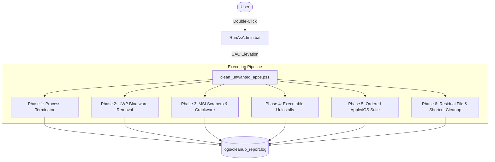

# Technical Architecture — SystemCleaner

## 1. System Overview
SystemCleaner operates as a modular PowerShell automation engine with a native Windows batch wrapper for administrative privilege elevation:

## 2. Component Structure
- `clean_unwanted_apps.ps1`: Primary PowerShell orchestration script.
- `RunAsAdmin.bat`: Bootstrap batch file requesting UAC `RunAs` elevation.
- `tests/test_cleaner.py`: Python syntax and schema verification test suite.
- `tests/cleaner.tests.ps1`: Pester test definitions.
- `logs/cleanup_report.log`: Execution audit trail with ISO timestamps.

## 3. Data Flow & Security Boundaries
- **Query Phase**: Queries `HKLM:\Software\Microsoft\Windows\CurrentVersion\Uninstall` (both 64-bit and Wow6432Node), `HKCU`, and `Get-AppxPackage`.
- **Termination Phase**: Gracefully stops blocking daemons (`iCloudServices`, `mDNSResponder`, etc.) to prevent file-lock conflicts.
- **Uninstallation Phase**: Executes silent `msiexec.exe /x {GUID} /qn /norestart` and silent uninstaller flags.
- **Verification Phase**: Re-queries uninstall registry keys to confirm zero leftover registrations.
