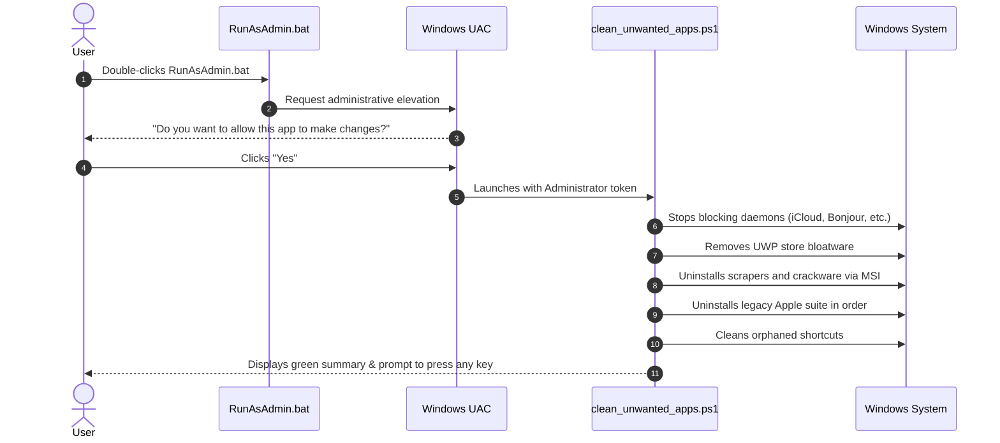

# User Experience Flows — SystemCleaner

## 1. Flow Overview
SystemCleaner provides two primary user journeys:
1. **Interactive Elevated One-Click Cleanup** (Via `RunAsAdmin.bat`)
2. **CLI Audit & Automation** (Via PowerShell `-AuditOnly` or `-Execute`)

## 2. Interactive Flow Details

## 3. Edge Cases Handled
- **Process Lock**: Automatically terminates daemons before calling MSI uninstaller.
- **Application Already Removed**: Gracefully skips without error.
- **Non-Elevated Invocation**: Warns user and directs them to run `RunAsAdmin.bat`.
